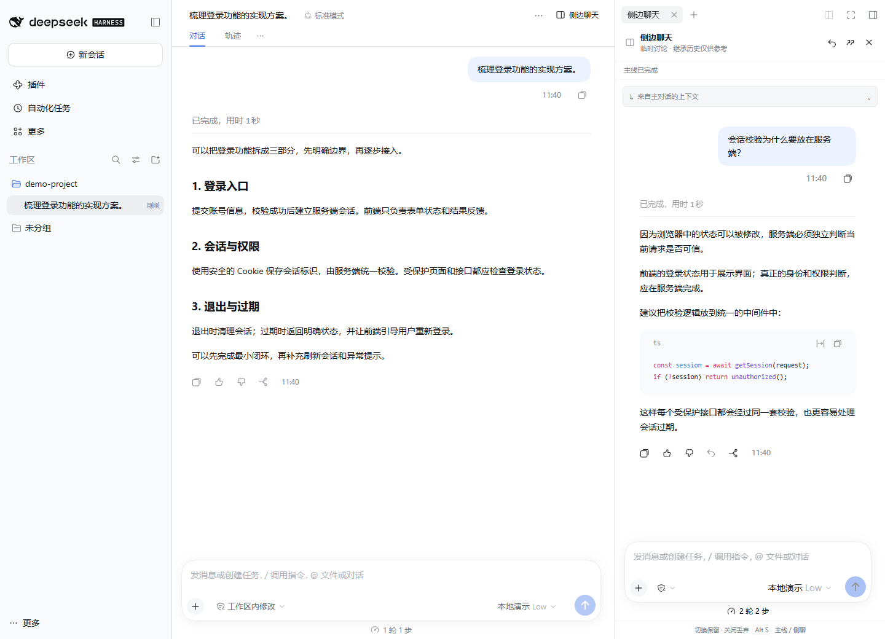

# DSH Sidechat

为 DeepSeek Harness 添加 Codex 式侧边聊天，让追问和讨论留在主任务旁边。



- **独立讨论**：主线继续执行，侧聊单独追问。
- **引用与回传**：划选原文提问，将结论带回主对话草稿。
- **实时状态**：提示主线完成、失败、等待回答或审批。
- **临时会话**：切换保留，关闭后停止并丢弃。

## 安装

适配 **DSH 0.2.1-rc.3**。

Web 端执行：

```powershell
dsh plugin --profile web add "github:Admilkk/dsh-sidechat#v0.2.2"
```

桌面端可从 [Releases](https://github.com/Admilkk/dsh-sidechat/releases/latest) 下载 `.tgz`，在插件管理中安装。安装后重启 DSH。

## 使用

点击主会话顶部的「侧边聊天」，或输入 `/side`；`Alt+S` 切换主线与侧聊焦点。

侧聊继承创建时的主线上下文，只执行在侧聊中新提出的请求。回复旁的回传按钮会把内容加入主线草稿，不会自动发送。

## 许可

[AGPL-3.0-only](LICENSE)。基于 DSH 官方 SDK 独立实现。
